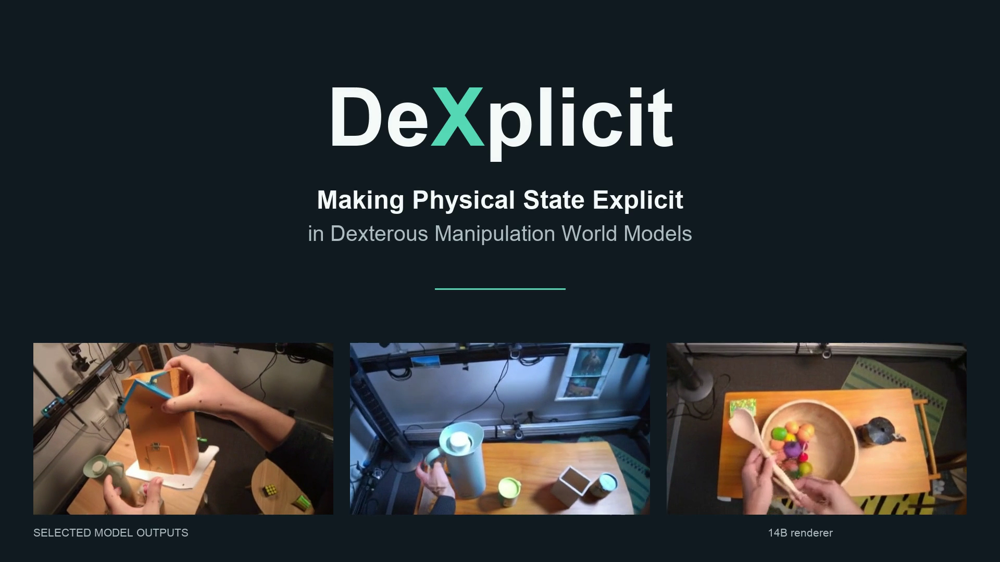
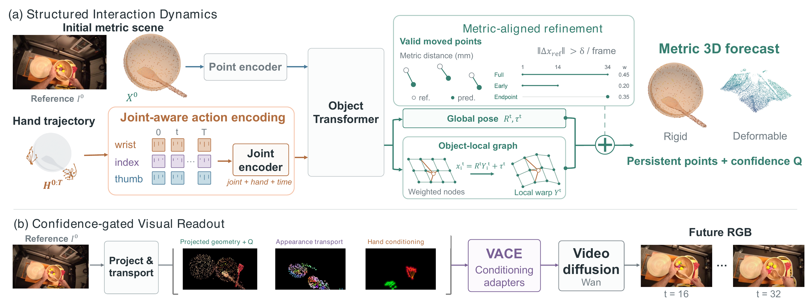
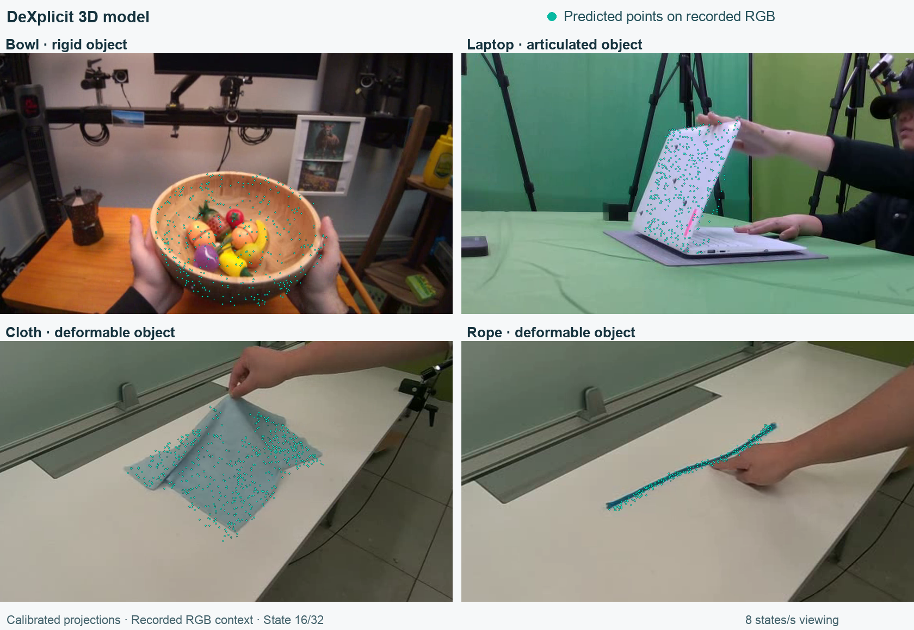

<div align="center">

# DeXplicit

### Making Physical State Explicit in Dexterous Manipulation World Models

[Adam Lee](https://abecid.com/)<sup>1</sup>,
[Mutian Xu](https://mutianxu.github.io/)<sup>2,†</sup>,
[Yukang Cao](https://yukangcao.github.io/)<sup>2</sup>,
[Shulin Tian](https://shulin16.github.io/)<sup>2</sup>,
[Ziwei Liu](https://liuziwei7.github.io/)<sup>2,‡</sup>

<sup>1</sup>University of California, Berkeley · <sup>2</sup>Nanyang Technological University<br>
<sup>†</sup>Project Lead · <sup>‡</sup>Corresponding Author

**[Project page](https://dexplicit.github.io/) · [Weights](https://huggingface.co/Abecid/DeXplicit) · [Models](#models)**

**Predict object response in metric 3D, then render its visual consequences.**

[](https://dexplicit.github.io/assets/demo/dexplicit-demo-1f6e7eac.mp4)

[Watch the full 1:12 demo](https://dexplicit.github.io/assets/demo/dexplicit-demo-1f6e7eac.mp4) · DeXplicit renderer (14B)

</div>

Given an initial image, metric scene points, and a future hand trajectory, the **DeXplicit 3D model** forecasts object motion. The **DeXplicit renderer** turns projected geometry and transported initial appearance into future RGB.

- **Anatomical actions:** joint identity, hand structure, and motion distinguish articulation from whole-hand transport.
- **Structured object dynamics:** a shared object pose captures coherent motion; a local graph captures articulation and deformation.
- **Persistent appearance:** point identities carry the initial appearance into future views, connecting the physical forecast to visual synthesis.

[Method](#method) · [Results](#results) · [Models](#models) · [Quickstart](#quickstart) · [Training](#training) · [Citation](#citation)

## Method

[](assets/method.pdf)

**Paper overview.** Joint-aware hand actions drive shared object transport and local deformation. Metric-aligned refinement improves the 3D forecast. Projected geometry, transported appearance, and hand controls condition the DeXplicit renderer. [Open the vector figure](assets/method.pdf).

Standard inference and renderer training both use **predictions from the DeXplicit 3D model** as renderer conditions. Appearance comes from the initial image; hand trajectories and calibrated cameras are supplied inputs. Renderer configurations are listed [below](#models).

## Results

### Rigid, articulated, and deformable object forecasts

[](assets/predicted-3d.mp4?raw=true)

[Watch the forecast overlay](assets/predicted-3d.mp4?raw=true). Teal points are saved 3D predictions; the background is recorded RGB. The video shows states 0–20 of the paper examples.

### DeXplicit renderer

14B renderer evaluation: 48 windows, including 45 with object-IoU support.

| Object IoU ↑ | LPIPS ↓ | PSNR ↑ | SSIM ↑ |
|:---:|:---:|:---:|:---:|
| **0.549** | **0.274** | **19.13** | **0.652** |

Forecast-conditioned pipeline checks are recorded in [verification](docs/VERIFICATION.md).

## Models

| Model | Weights | Role / interface |
|---|---|---|
| **DeXplicit 3D model** | `dexplicit-3d-model.safetensors` · 1.70 GB | Initial metric scene + hand actions → 35 states of 3D points |
| **DeXplicit renderer** | `dexplicit-renderer-high.safetensors` + `dexplicit-renderer-low.safetensors` · 61.4 MB each | Default 14B renderer; native projected RGB-cache controls → 33 RGB frames at 832 × 480 |
| **DeXplicit renderer (compact)** | `dexplicit-renderer-compact.safetensors` · 118.8 MB | Optional 1.3B renderer with learned hand/feature branches and a separate prepared-input interface |

The default renderer uses the frozen [Wan2.2-VACE-Fun-A14B](https://huggingface.co/alibaba-pai/Wan2.2-VACE-Fun-A14B) backbone. Adapter downloads exclude the upstream backbone, text encoder, VAE, and tokenizer. [Checkpoint identities and hashes](checkpoints.json).

## Quickstart

### 1. Install

```bash
git clone https://github.com/Abecid/DeXplicit.git
cd DeXplicit
```

Follow [installation](docs/INSTALL.md) to create `.venv-geometry` and `.venv-video` with the pinned CUDA dependencies and DiffSynth backend. The tested default configuration uses Linux, Python 3.10, an 80 GB NVIDIA GPU, and CPU offloading; reserve at least 128 GB system RAM and about 81 GB for the upstream model files.

### 2. Download weights

```bash
.venv-video/bin/python -m dexplicit.download --output-dir weights
```

The downloader pins the Hugging Face revision and verifies every checkpoint against [checkpoints.json](checkpoints.json). It downloads the DeXplicit 3D model and both default renderer adapters. For the compact renderer, add `--model renderer-compact`.

### 3. Predict 3D and generate video

Prepare an initial-only input from a processed sequence:

```bash
.venv-geometry/bin/python -m dexplicit.geometry prepare \
  --data-dir data/processed/hot3d --sample CLIP_STEM \
  --output data/geometry-input.safetensors
```

Run the complete pipeline:

```bash
.venv-video/bin/python -m dexplicit.infer \
  --input data/geometry-input.safetensors \
  --initial-image data/initial.png --camera data/camera.npz \
  --weights-dir weights --output-dir runs/example \
  --geometry-python .venv-geometry/bin/python \
  --backend third_party/DiffSynth-Studio
```

| Output | Contents |
|---|---|
| `predicted-controls/forecast.npz` | Unchanged 35-state metric point forecast |
| `predicted-controls/controls.npz` | Projected controls, coverage masks, and initial reference image |
| `video.mp4`, `rgb.npz` | 33 generated RGB frames at 832 × 480 |
| `receipt.json` | Input/output hashes, checkpoint identities, and sampler settings |

Geometry runs first and releases its GPU memory before the renderer loads. Video uses forecast states 0–32 with aligned hand and camera controls. See [data preparation and input schemas](docs/DATA.md) for the required scene, image, and camera files.

Defaults: 30 steps, CFG 5, seed 17, shift 5, and expert transition at timestep 875. For offline use, pass `--base-model-dir /path/to/Wan2.2-VACE-Fun-A14B`. Standalone entry points are `dexplicit.geometry infer` and `dexplicit.renderer`; each supports `--help`.

## Training

Fine-tune the DeXplicit 3D model with its native structured architecture and metric losses:

```bash
.venv-geometry/bin/python -m dexplicit.train_geometry \
  --weights weights/dexplicit-3d-model.safetensors \
  --data-dir data/processed/hot3d --output-dir runs/geometry-ft --steps 1000
```

For the DeXplicit renderer, `dexplicit.prepare_renderer` generates conditions with the frozen DeXplicit 3D model, then `dexplicit.train_renderer --phase high|low` fine-tunes each expert. Future RGB is the training target. The complete manifest, preparation, and training commands are in [training recipes](docs/TRAINING.md).

## Documentation

| Guide | Contents |
|---|---|
| [Installation](docs/INSTALL.md) | Tested environments, GPU requirements, and offline setup |
| [Data](docs/DATA.md) | Geometry inputs, camera calibration, and renderer bundles |
| [Training](docs/TRAINING.md) | Geometry fine-tuning and predicted-3D renderer training |
| [Verification](docs/VERIFICATION.md) | Installed-package inference, control parity, and training checks |
| [Licensing](docs/LICENSING.md) | Code, model, upstream, and dataset terms |

## Citation

```bibtex
@misc{lee2026dexplicit,
  title={DeXplicit: Making Physical State Explicit in Dexterous Manipulation World Models},
  author={Lee, Adam and Xu, Mutian and Cao, Yukang and Tian, Shulin and Liu, Ziwei},
  year={2026},
  url={https://dexplicit.github.io/}
}
```

## Acknowledgements

Built on [PointWorld](https://github.com/NVlabs/PointWorld), [Point Transformer V3](https://github.com/Pointcept/PointTransformerV3), [Wan](https://github.com/Wan-Video/Wan2.1), [VACE](https://github.com/ali-vilab/VACE), and [DiffSynth-Studio](https://github.com/modelscope/DiffSynth-Studio). See [third-party notices](THIRD_PARTY_LICENSES.md).

Code: [Apache-2.0](LICENSE). Weights: [Apache-2.0](LICENSE-WEIGHTS). [Upstream and dataset terms](docs/LICENSING.md).
